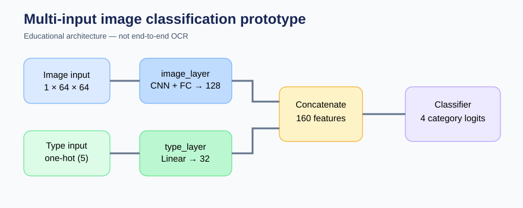

# Multi-Input Insurance Document Classifier | PyTorch

[](https://www.python.org/)
[](https://pytorch.org/)
[](LICENSE)

An educational **multi-input image classification prototype** built with PyTorch. It combines a grayscale document-like image with auxiliary document-type information to predict one of several categories.

> **Important:** This project uses **synthetic geometric images**, not scanned insurance records. It is **not a complete OCR system** and its demonstration metrics do not establish performance on real documents or identity codes.

## Model architecture



- **Image input:** 64 × 64 grayscale image (`1 × 64 × 64`)
- **Image branch:** `image_layer`, with `Conv2d` layers (`kernel_size=3`, `padding=1`), ReLU, pooling and fully connected layers
- **Metadata input:** one-hot encoded document-type vector (5 example types)
- **Metadata branch:** `type_layer`, producing a 32-dimensional representation
- **Fusion:** concatenates 128 image features and 32 metadata features
- **Output:** classification logits for 4 example categories

The model predicts a **category**. It does **not** detect, read, or transcribe text from an image. Full OCR would additionally need text detection/recognition, with metrics such as CER and WER.

## Repository files

All files are currently kept in the **repository root** (no `src/`, `assets/` or `notebooks/` subfolders).

```text
insurance-document-classifier-pytorch/
├── .gitignore
├── LICENSE
├── README.md
├── requirements.txt
├── ocr_model.py            # OCRModel architecture
├── data.py                 # Synthetic data and optional CSV image dataset
├── train.py                # Training, validation and output files
├── 01_walkthrough.ipynb    # Explained, reproducible Jupyter Notebook
├── architecture.svg        # Model architecture illustration
└── dataset_format.csv      # Example CSV column format (not real data)
```

## Quick start

Clone the project and enter its directory:

```bash
git clone https://github.com/melikekarakus20/insurance-document-classifier-pytorch.git
cd insurance-document-classifier-pytorch
```

Create and activate a virtual environment:

**Windows (PowerShell)**

```powershell
python -m venv .venv
.\.venv\Scripts\Activate.ps1
```

**macOS / Linux**

```bash
python3 -m venv .venv
source .venv/bin/activate
```

Install dependencies:

```bash
pip install -r requirements.txt
```

Train with synthetic example data for 10 epochs:

```bash
python train.py --demo --epochs 10
```

Run the interactive walkthrough:

```bash
jupyter lab 01_walkthrough.ipynb
```

> The notebook must contain root-level imports (`from ocr_model import OCRModel`, `from data import make_demo_dataset`, `from train import run_training`). Use the accompanying **updated notebook** if the uploaded version still imports `src.ocr_model`.

## Outputs

Running `train.py` creates an `outputs/` folder locally containing:

- `model.pt` — saved model state and configuration
- `metrics.json` — training/validation losses and validation accuracy for each epoch
- `loss_curve.png` — training and validation loss chart

These results are based only on the synthetic geometric demonstration data. Validation uses a random 80/20 holdout, which is not a substitute for a rigorous real-document evaluation.

## Using your own dataset

Supply a CSV with these columns:

| Column | Description |
|---|---|
| `image_path` | Path to image, relative to the CSV file's folder |
| `type_id` | Document-type index, from 0 to `num_types - 1` |
| `label` | Category index, from 0 to `num_classes - 1` |

The included [`dataset_format.csv`](dataset_format.csv) illustrates the CSV layout; its paths are placeholders, **not included image files**.

Example:

```bash
python train.py --csv private_data/labels.csv --num-types 5 --num-classes 4 --epochs 10
```

The image loader converts images to grayscale and resizes them to 64 × 64. This resolution may erase small text; verify its suitability before adapting the project for actual OCR. Only use documents you are authorized to process, with identifying information appropriately protected. Never commit real personal IDs or unredacted insurance records.

## Limitations and next steps

1. Train and test with properly sourced, anonymized and labeled document images.
2. Split train/test data by document or customer to reduce leakage.
3. Evaluate precision, recall, F1 and confusion matrices across categories.
4. Add actual text recognition, plus character/word error rate (CER/WER).
5. Assess privacy, quality controls, robustness and human review before practical use.

## License

MIT — see [LICENSE](LICENSE).
